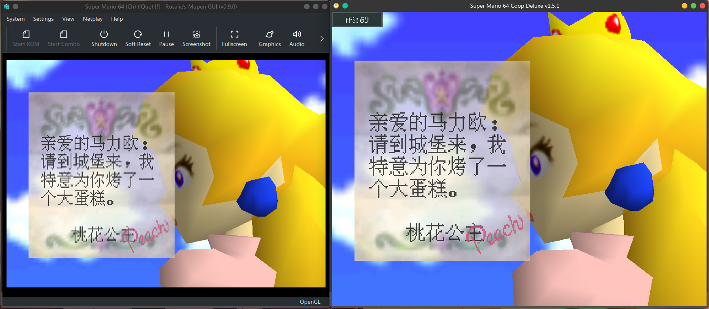

**English** | [简体中文](README.md)

<div align="center">

# sm64-iQueDeluxe

**A patch that brings the *iQue Mario 64* Chinese localisation assets into Super Mario 64 Co-op Deluxe**

 <br>


</div>

## What this is

A patch for Super Mario 64 Co-op Deluxe that lets the game use the Chinese localisation assets from *iQue Mario 64*
(神游马力欧64, the officially localised Chinese release of Super Mario 64).

The goal is a 1:1 port of that localisation into sm64coopdx — so you never have to stare at the original script
wondering what anyone is talking about again.

**Note: this is not a 1:1 reimplementation of everything the iQue release did.** Anything that is not part of the
localisation — behaviour, textures, models, level geometry — is identical to the US SM64 ROM.

## Usage

You must own a legitimate `.z64` dump of *iQue Mario 64*. This repository contains no ROM and no textures.

```
Super Mario 64 (Ch) (iQue) [!]: 29047fba820695bd14c5bd7aa1aa4400
```

Once you have verified the checksum, put the ROM in the root directory of the sm64coopdx build that already has
iQue Deluxe applied (the `User` directory works too). If everything is in place, the iQue localisation assets
switch on automatically.

## Features

 - Simple djui frontend toggle
 - Near 1:1 reproduction of *iQue Mario 64*
 - Self-contained font system; Chinese is supported at the code level, not by texture hacks
 - Localised title screen — enable [Vanilla SM64 Title Screen](https://mods.sm64coopdx.com/mods/vanilla-sm64-title-screen.1287/) so Coopdx actually shows one
 - Coexists with [djui_modern](https://github.com/Shangshanruo666/djui_modern) (**requires the localised upstream**; djui_modern does not support stock Coopdx yet)
 - Hot-swappable — toggling the iQue assets does not need a restart
 - Desktop and Android
 - Can build native packages for a given distro

## Building

```bash
git clone https://github.com/toad114514/sm64iquedx --depth 1
cd sm64iquedx

# With no arguments it asks you interactively
sh ./install.sh

# Or pass the options directly
sh ./install.sh -h                        # list every option
sh ./install.sh -f -p deb                 # with the frontend toggle, produce a .deb
sh ./install.sh -c -f -p rpm              # localised upstream + frontend + .rpm
sh ./install.sh -c -d -f -p mac           # localised upstream + djui_modern, produce .app / .dmg
sh ./install.sh -a -c                     # build only the localised Android APK
```

Some of the available options:

| Option | Effect |
| --- | --- |
| `-a, --android` | Build only the Android APK (needs NDK + Gradle); takes precedence over `--package` |
| `-c, --chinese` | Use the localised upstream repos `sm64coopdx-Chinese` / `sm64coopdx-Chinese-Android`, maintained by `上善若&梅塔的长名字` |
| `-f, --frontend` | Apply `patches/0007-djui-frontend.patch`, adding a toggle under Settings → Other; without it you can only edit the config file |
| `-d, --djmd` | Apply the [djui_modern](https://github.com/Shangshanruo666/djui_modern) module. **Only valid together with `-c`** |
| `-p, --package <kind>` | Package the contents of `dist/` into a native package or a portable archive |

`--package` produces a different artefact per platform:

- Debian-based → `sm64coopdx-iquedx_<version>_<arch>.deb`, install with `apt install`
- Arch-based → `sm64coopdx-iquedx-<version>-<rel>-<arch>.pkg.tar.zst`
  - The plan was to publish it on the AUR, but registration is closed at the moment, so `yay -S sm64coopdx-iquedx` is not available yet
- Red Hat family / openSUSE → `sm64coopdx-iquedx-<version>-<rel>.<arch>.rpm`
- macOS → `SM64CoopDeluxe.app`, wrapped in a `.dmg` by default
- Windows → `sm64coopdx-iquedx-<version>-setup.exe`, an Inno Setup wizard (`InnoSetup Powered`)
- Any other Linux / Unix / whatever → `--package other` just prints the install command; the payload lives in `/opt/sm64coopdx-iquedx` by default

You can also fork the repo and build it with GitHub Actions, or ask for a ready-made build in 上善若's Chinese
localisation group at https://qm.qq.com/q/twjhRVjgWs *(not published openly, to keep the Chinese Mario scene
manageable)*.

## Filing issues

Use the GitHub issue template. Bug reports that ignore it are ignored outright.

## Legal

This repository is released under the MIT License.
`platform/windows/ChineseSimplified.isl` comes from
[kira-96/Inno-Setup-Chinese-Simplified-Translation](https://github.com/kira-96/Inno-Setup-Chinese-Simplified-Translation)
and is also MIT licensed.
All assets, textures and text from *iQue Mario 64* are copyright Nintendo and iQue. They are not covered by this
repository's licence and are included for research and personal use only.

## Repository layout

This repo stores only the **changes**, never a full copy of the upstream sources:

- `src/` — modified files, **mirroring the upstream paths exactly** (the single edit source)
- `patches/` — patch files; a few tiny changes are not patches but live in `scripts/`
- `platform/` — per-platform extras and packaging, e.g. the Debian `control` file
- `scripts/` — patch generators plus small post-apply fixups
- `upstream.txt` — the patch baseline (upstream repo + commit)

For the patch index and application order see [patches/README.en.md](patches/README.en.md). After editing `src/`,
regenerate the shared patches with `scripts/gen_all_patches.sh` and the Android patch with
`scripts/gen_platform_patches.py`. To stack the patches by hand without building, use
`scripts/apply_patches.sh <pc|android|android-cn> <upstream dir> [--frontend]`; running it twice is safe.
Conventions are documented in [docs/LAYOUT.en.md](docs/LAYOUT.en.md).

The docs are bilingual: this page ([简体中文](README.md)), [patches/README](patches/README.en.md)
([简体中文](patches/README.md)), [docs/LAYOUT](docs/LAYOUT.en.md) ([简体中文](docs/LAYOUT.md)). Both versions of a
document must be changed together.
