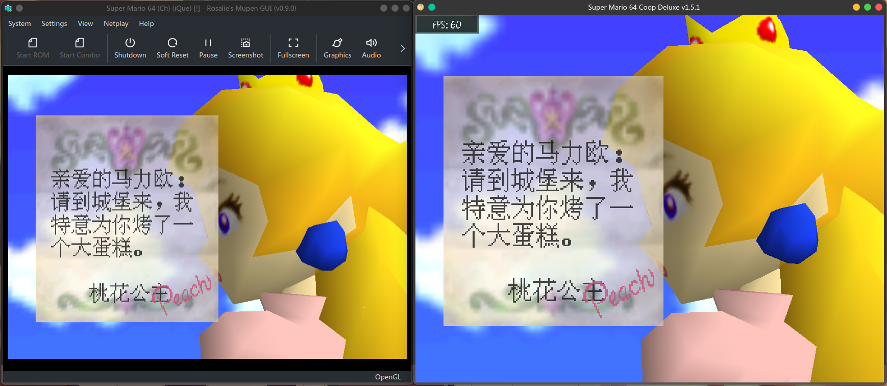

<div align="center">

# sm64-iQueDeluxe

**适用于 Super Mario 64 Co-op Deluxe 的《神游马力欧64》ROM 汉化资源兼容补丁**

 <br>


</div>

## 简介
这是一个用于在 Super Mario 64 Co-op Deluxe 下使用《神游马力欧64》汉化资源的补丁   
皆在将《神游马力欧64》的汉化完全一比一搬入 sm64coopdx  
彻底解决妈妈再也不怕我看不懂原版的马力欧64剧情啦aaa  
**注意：项目并不是将神游版的所有特性直接一比一复刻！非汉化的部分例如特性、纹理、模型和地图等都与美版 SM64 Rom 相同！**   

## 使用
你必须拥有一个合法的《神游马力欧64》的 z64 decomp 副本，本仓库不包含 Rom 和任何纹理。  
Super Mario 64 (Ch) (iQue) \[\!\]：`29047fba820695bd14c5bd7aa1aa4400`  
确认无误后将 ROM 放置在已经应用了 Ique Deluxe 的 sm64coopdx 程序根目录（或者放置在 User 目录也可）  
如果操作无误，那么神游汉化资源功能将自动打开

## 特性
 - 简易的 djui 前端开关
 - 接近一比一复刻《神游马力欧64》
 - 内置独立的字体系统，代码层面完全支持中文
 - 标题画面汉化支持，启用 [Vanilla SM64 Title Screen](https://mods.sm64coopdx.com/mods/vanilla-sm64-title-screen.1287/) 可以让 Coopdx 显示标题画面
 - 可与 [djui_modern](https://github.com/Shangshanruo666/djui_modern) 模块共存（**必须搭配汉化上游**，目前 djui_modern 还没有支持原版 Coopdx）
 - 热切换，切换神游资源无需重启
 - 桌面/安卓 多平台支持
 - 支持生成特定系统的软件包

## 编译

```bash
git clone https://github.com/toad114514/sm64iquedx --depth 1
cd sm64iquedx

# 不带参数会询问编译选项
sh ./install.sh

# 也可以直接用参数
sh ./install.sh -h                        # 列出全部选项
sh ./install.sh -f -p deb                 # 带前端开关，生成 .deb
sh ./install.sh -c -f -p rpm              # 汉化上游 + 前端 + .rpm
sh ./install.sh -c -d -f -p mac           # 汉化上游 + djui_modern，出 .app / .dmg
sh ./install.sh -a -c                     # 只构建 Android 汉化版 APK
```

可用的部分参数：

| 参数 | 作用 |
| --- | --- |
| `-a, --android` | 只构建 Android APK（需要 NDK + Gradle），优先级高于 `--package` |
| `-c, --chinese` | 使用 `上善若&梅塔的长名字` 制作的汉化版上游仓库 `sm64coopdx-Chinese` 或 `sm64coopdx-Chinese-Android` |
| `-f, --frontend` | 应用 `patches/0007-djui-frontend.patch`，在 设置 → 其他 里添加简易开关；不应用时只能改配置文件 |
| `-d, --djmd` | 应用 [djui_modern](https://github.com/Shangshanruo666/djui_modern) 模块。**只能与 `-c` 搭配使用** |
| `-p, --package <方式>` | 将 dist/ 内容打包成软件包或 portable 压缩包 |

`--package` 可根据情况打包成以下不同的软件包：

- Debian 系 → 生成 `sm64coopdx-iquedx_<版本>_<架构>.deb` 并使用 `apt install` 安装
- Arch 系 → 生成 `sm64coopdx-iquedx-<版本>-<rel>-<架构>.pkg.tar.zst`
  - 本来想提交到 AUR 的，最近不给注册开放，所以目前还不能 `yay -S sm64coopdx-iquedx`
- 红帽系 / openSUSE → 生成 `sm64coopdx-iquedx-<版本>-<rel>.<架构>.rpm`
- macOS → 生成 `SM64CoopDeluxe.app`，默认再包一层 `.dmg`
- Windows → 生成 `sm64coopdx-iquedx-<版本>-setup.exe` 安装向导 exe 文件 `InnoSetup Powered`
- 其他 Linux / Unix / 乱七八糟的平台 → `--package other` 只提示安装命令，本体默认存储在 `/opt/sm64coopdx-iquedx`

也可以 fork 后用 GitHub Actions 自己编译，或到上善若的汉化群 https://qm.qq.com/q/twjhRVjgWs 找我要成品 *（为控制国内马里奥圈小鬼数量不直接发布）*。

## 提交 Issue
请使用 Github 的模板表单！否则任何 Bug Issue 一律忽略！

## 声明
本仓库使用 MIT License 协议开源  
`platform/windows/ChineseSimplified.isl` 来自 [kira-96/Inno-Setup-Chinese-Simplified-Translation](https://github.com/kira-96/Inno-Setup-Chinese-Simplified-Translation) 使用 `MIT License` 许可证开源  
所有出现《神游马力欧 64》的资源、纹理、文本，版权归任天堂、神游所有，不在本仓库许可范围内，仅作研究与个人用途。

## 仓库结构

本仓库只存「改动」不存上游全量源码：

- `src/` —— 被改过的文件，**路径与上游逐级一致**（唯一编辑源）
- `patches/` —— 补丁文件，但一部分没有做成补丁，微小更改被放在 `scripts/`
- `platform/` ——  针对特殊平台的其他内容和打包，例如 Debian 包所需的 control
- `scripts/` —— 补丁生成脚本和用于补丁后的小修补
- `upstream.txt` —— 补丁基线（上游仓库 + commit）

补丁索引与应用顺序见 [patches/README.md](patches/README.md)；改完 `src/` 用 `scripts/gen_all_patches.sh` 重生成共用补丁、`scripts/gen_platform_patches.py` 重生成 Android 补丁。不构建、只想手动叠加补丁时用 `scripts/apply_patches.sh <pc|android|android-cn> <上游目录> [--frontend]`，重复执行安全。约定详见 [docs/LAYOUT.md](docs/LAYOUT.md)。
